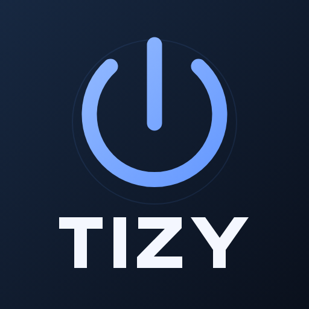
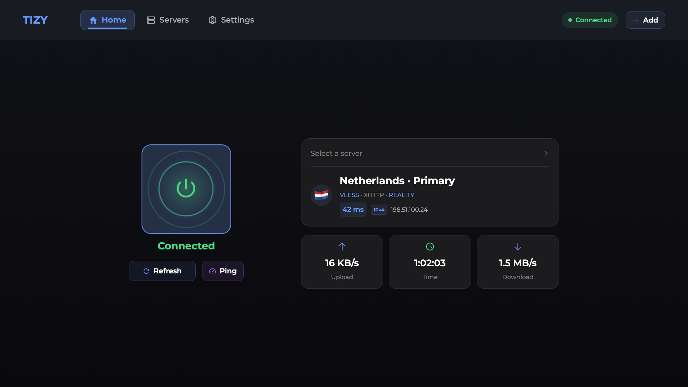
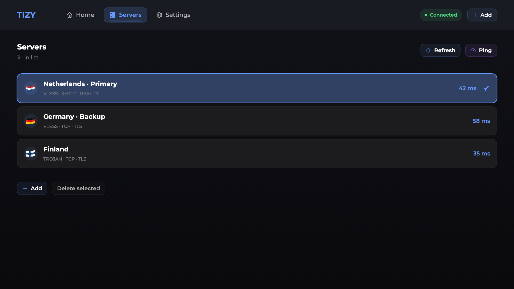

<h1 align="center">TIZY</h1>

<strong>A remote-friendly VPN client for Samsung Tizen TVs.</strong>

[Русский](README.ru.md) · [Installation](docs/INSTALLATION.md) · [Compatibility](docs/COMPATIBILITY.md) · [Build](docs/BUILD.md)

TIZY combines a TV interface, Xray-core and an existing [Vetro](https://github.com/andrearicci93/vetro) UID-0 integration. Bring your own server or subscription; no VPN service or credentials are included.

## Features

- VLESS, VMess, Trojan and Shadowsocks; supported TCP, WebSocket, gRPC and XHTTP configurations.
- Link/HTTPS subscription import and QR transfer from Incy, Happ and v2RayTun.
- Last-server autoconnect, reconnect and per-application routing.
- IPv4/IPv6 server preference, latency, traffic statistics and optional exportable logs.
- Russian, English, Turkish and Simplified Chinese.
- Local [Vetro](https://github.com/andrearicci93/vetro) port discovery and ARMv7/ARM64 core selection.

## Install

Download the installation ZIP from [Releases](https://github.com/mxbforge/tizy/releases), extract its WGT and install it with [Apps2Samsung](https://github.com/Apps2Samsung/Apps2Samsung/releases). First configure a compatible [Vetro](https://github.com/andrearicci93/vetro) root integration, then restore its autonomous connection after installation. Use your own signing certificate. [Step-by-step guide](docs/INSTALLATION.md).

## Compatibility and scope

The manifest requires Tizen TV 6.0+. A functioning [Vetro](https://github.com/andrearicci93/vetro) integration, Node.js 10+ and compatible kernel networking features are also required. Hardware testing covers **QE50QN90AAUXRU / T-NKM2DEUC-2310.0 / ARMv7**. ARM64 binary hashes and ELF format were checked; ARM64 hardware has not been tested.

Application traffic redirection covers TCP and DNS, with direct IPv6 and UDP/QUIC restricted according to policy. This is not a full system TUN implementation. A ready core does not establish that a remote server is reachable. Root can take time after startup; TIZY does not create persistent root or modify TV firmware.

Home, server management and per-app routing in TIZY. [Server list](assets/screenshots/servers.png) · [Per-app routing](assets/screenshots/settings.png). Logging defaults off on a new installation; upgrades preserve existing preferences. See [privacy and external services](docs/PRIVACY.md).

## Remote control

In Servers, press **OK** to select a profile and open Home. Hold **OK** while the VPN is disconnected to select it without leaving the list. The selection check appears when the service confirms the change. Use the arrows to move focus and Back to return.

## Development and licensing

See [BUILD.md](docs/BUILD.md). Original client code is MIT licensed; Xray-core and other bundled components retain their own licenses. [Third-party notices](THIRD_PARTY_NOTICES.md).
