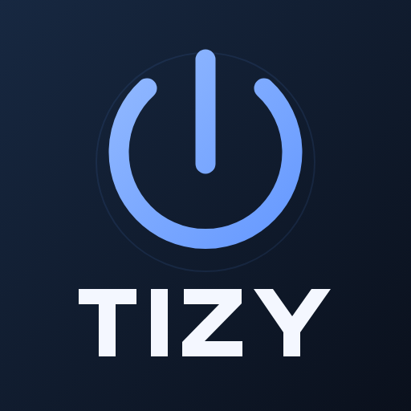
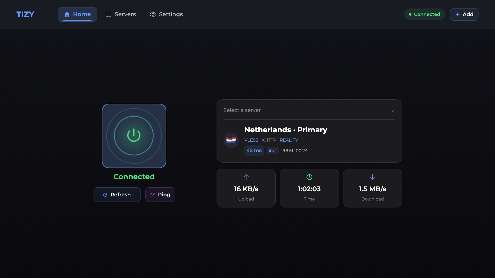
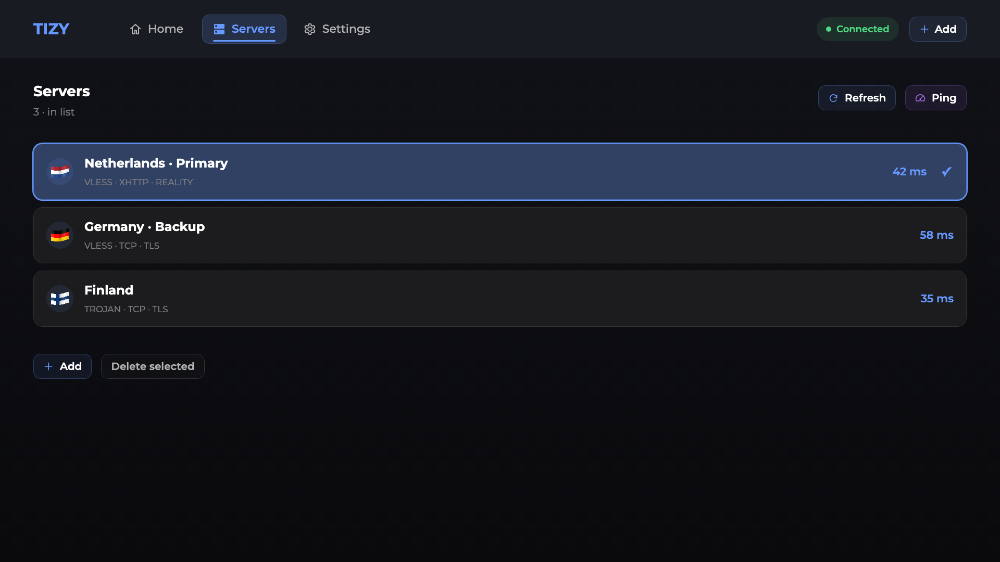

<p align="center"><a href="assets/icon.png" target="_blank" rel="noopener noreferrer"></a></p>

<h1 align="center">TIZY</h1>

<p align="center"><strong>VPN-клиент для Samsung Tizen с управлением с пульта.</strong></p>

Добавьте свой сервер, выберите приложения и подключайтесь прямо на телевизоре. TIZY использует Xray-core и уже работающий root-доступ [Vetro](https://github.com/andrearicci93/vetro).

[Установка](docs/INSTALLATION.md) · [Совместимость](docs/COMPATIBILITY.md) · [Вопросы и ошибки](docs/TROUBLESHOOTING.md) · [Сборка](docs/BUILD.md) · [English](README.md)

## Скачать

| Файл | Назначение |
|---|---|
| [TIZY-0.14.4-Universal-install.zip](https://github.com/mxbforge/tizy/releases/download/v0.14.4/TIZY-0.14.4-Universal-install.zip) | **Установка на ТВ** — WGT и лицензии |
| [TIZY-0.14.4-source.zip](https://github.com/mxbforge/tizy/releases/download/v0.14.4/TIZY-0.14.4-source.zip) | Исходный код выпуска |
| [TIZY-0.14.4-screenshots-en.zip](https://github.com/mxbforge/tizy/releases/download/v0.14.4/TIZY-0.14.4-screenshots-en.zip) | Скриншоты интерфейса — PNG, 1920×1080 |
| [SHA256SUMS.txt](https://github.com/mxbforge/tizy/releases/download/v0.14.4/SHA256SUMS.txt) | SHA256 файлов релиза |
| [TIZY-0.14.4-Universal.sha256](https://github.com/mxbforge/tizy/releases/download/v0.14.4/TIZY-0.14.4-Universal.sha256) | SHA256 WGT после распаковки |

Распакуйте установочный архив и установите WGT через [Apps2Samsung](https://github.com/Apps2Samsung/Apps2Samsung/releases). [Инструкция по установке](docs/INSTALLATION.md).



## Возможности

- VLESS, VMess, Trojan и Shadowsocks; TCP, WebSocket, gRPC и XHTTP в поддерживаемых конфигурациях.
- Добавление ссылок и HTTPS-подписок; передача через QR из Incy, Happ и v2RayTun.
- Автоподключение к последнему выбранному серверу и восстановление соединения после сбоя.
- Прокси по приложениям: выбранные приложения через VPN либо напрямую.
- Выбор IPv4, IPv6 или автоматического режима соединения с сервером.
- Пинг серверов, сведения о подключении, скорость и журнал с экспортом.
- Русский, English, Türkçe и 简体中文.
- Автоматический поиск локального порта [Vetro](https://github.com/andrearicci93/vetro) и выбор ARMv7/ARM64.

TIZY использует ваш сервер или подписку. Встроенных серверов и VPN-услуги в комплекте нет.

## Установка

1. Проверьте [совместимость](docs/COMPATIBILITY.md) и подготовьте [Vetro](https://github.com/andrearicci93/vetro) с подключённым root-agent (`uid=0`).
2. Скачайте установочный комплект [TIZY-0.14.4-Universal-install.zip](https://github.com/mxbforge/tizy/releases/download/v0.14.4/TIZY-0.14.4-Universal-install.zip) и распакуйте его.
3. Установите находящийся внутри `.wgt` через [Apps2Samsung](https://github.com/Apps2Samsung/Apps2Samsung/releases).
4. Верните автономное соединение [Vetro](https://github.com/andrearicci93/vetro) по его инструкции, откройте TIZY и добавьте свой сервер.

[Пошаговая инструкция →](docs/INSTALLATION.md)

Пакет не подписан чужим сертификатом: Apps2Samsung подписывает его для вашего ТВ. Наличие TIZY в каталоге Apps2Samsung не предполагается — используйте установку своего WGT.

## Управление с пульта

В разделе «Серверы» короткое **ОК** выбирает сервер и открывает главную страницу. Долгое **ОК** при отключённом VPN выбирает сервер, сохраняя текущий раздел. Галочка появляется после подтверждения выбора службой. Стрелки перемещают фокус; кнопка «Назад» возвращает на предыдущий экран.



## Требования и ограничения

Нужны Samsung Tizen TV 6.0+, Node.js 10+ на ТВ, работающая интеграция [Vetro](https://github.com/andrearicci93/vetro) с root и необходимые сетевые возможности ядра. Минимальная версия в манифесте не означает совместимость всех телевизоров.

Проверенная модель: **QE50QN90AAUXRU**, ПО **T-NKM2DEUC-2310.0**, ARMv7. ARM64-бинарник проверен по хешу и формату, но аппаратное тестирование ARM64-ТВ не проводилось.

В режиме перенаправления приложений поддерживается TCP и DNS через туннель. Прямые IPv6 и UDP/QUIC ограничиваются правилами выбранного режима; UDP-игры и звонки могут не работать. Подключение к самому VPN-серверу может использовать IPv4 или IPv6.

«Ядро готово» подтверждает запуск Xray, а не доступность удалённого сервера. Если сервер не отвечает из сети ТВ, увеличение ожидания или исправный root этого не устранят.

[Подробная совместимость и сеть →](docs/COMPATIBILITY.md)

## Данные и безопасность

Серверы и ключи хранятся на ТВ. При установке создаётся индивидуальный ключ локального API. Журнал по умолчанию выключен; обновление сохраняет ваш выбор. Импорт QR, подписки, определение страны и проверка соединения могут обращаться к внешним службам — [подробности](docs/PRIVACY.md).

Root — отдельная возможность [Vetro](https://github.com/andrearicci93/vetro). TIZY не получает постоянный root, не прошивает телевизор и не меняет загрузчик. Экспериментальные привилегированные приложения требуют понимания влияния на сеть и функции ТВ; процедуры получения root могут затронуть работоспособность, DRM и гарантийное обслуживание.

## Снимки интерфейса

[Главная](assets/screenshots/home.png) · [Серверы](assets/screenshots/servers.png) · [Настройки](assets/screenshots/settings.png)

Главная страница, список серверов и настройки маршрутизации TIZY.

## Разработка

```sh
npm ci --prefix deps --ignore-scripts
npm ci --ignore-scripts
npm run build
npm test
npm run test:ui
npm run test:integration
npm run test:package
```

Результат: `dist/TIZY-0.14.4-Universal.wgt`. Сборка создаёт переносимый пакет без общих ключей и данных устройств. [Инструкция разработчика](docs/BUILD.md).

## Лицензии и благодарности

Оригинальный клиент — [MIT](LICENSE). Xray-core — MPL-2.0; шрифты, флаги и зависимости сохраняют свои лицензии. Полные уведомления и ссылки на исходники: [THIRD_PARTY_NOTICES.md](THIRD_PARTY_NOTICES.md), [LICENSES](LICENSES).

Спасибо разработчикам [Xray-core](https://github.com/XTLS/Xray-core), [Vetro](https://github.com/andrearicci93/vetro), [Apps2Samsung](https://github.com/Apps2Samsung/Apps2Samsung) и протоколов передачи конфигураций. TIZY — независимый проект; это не официальное приложение Samsung, XTLS, [Vetro](https://github.com/andrearicci93/vetro) или Apps2Samsung.
